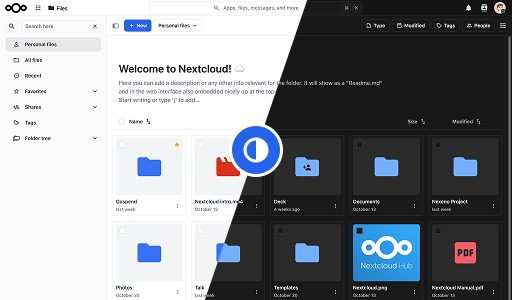
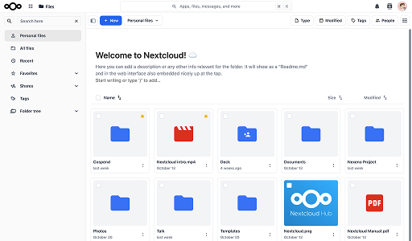
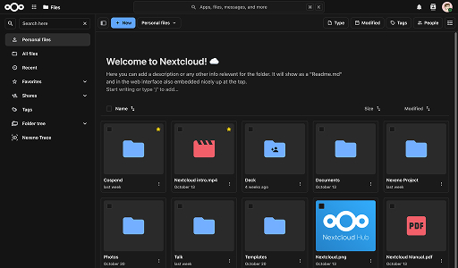

<!--
  - SPDX-FileCopyrightText: 2026 Nexeno contributors
  - SPDX-License-Identifier: AGPL-3.0-or-later
-->
<div align="center">


# Nexeno Theme - Ein Nextcloud-Theme

**Deine Cloud. Deine Marke.<br>Dein Erlebnis.**

[](https://github.com/Nexeno-HQ/nexeno_theme/releases/latest) [](#für-administratoren) [](#für-administratoren) [](LICENSE) [](https://apps.nextcloud.com/apps/nexeno_theme)

[English](README.md) · **Deutsch** · [Français](README.fr.md)


</div>

Nexeno Theme gestaltet Nextcloud und die Apps, die dein Team täglich nutzt, in einem einheitlichen Design. Es ist
ausgeschaltet, bis eine Person es einschaltet, und es verändert nie ihre eigenen Darstellungseinstellungen in
Nextcloud. Der Weg zurück ist also immer nur einen Klick entfernt. Entwickelt und gepflegt von
[Nexeno](https://nexeno.io/).

| Systemstandard | Nexeno Hell | Nexeno Dunkel |
|:---:|:---:|:---:|
|  |  |  |
| Folgt der Hell-/Dunkel-Einstellung des Geräts | Hell und ruhig für die Arbeit am Tag | Angenehm für die Augen am Abend |

## In einer Minute startklar

1. Öffne in Nextcloud **Apps**, suche nach **Nexeno Theme** und klicke auf **Herunterladen und aktivieren**.
2. Öffne **Persönliche Einstellungen → Darstellung und Barrierefreiheit**.
3. Wähle **Systemstandard**, **Nexeno Hell** oder **Nexeno Dunkel**. Das neue Aussehen erscheint sofort, in jedem
   offenen Tab.

Updates kommen über die App-Verwaltung von Nextcloud, wie bei jeder anderen App aus dem App Store.

## Für die Personen in deinem Team

- **Ihre Wahl, nicht deine.** Jede Person schaltet das Theme selbst ein oder aus. Niemand bekommt ein neues Aussehen
  aufgezwungen.
- **Überall dabei.** Die Wahl wird mit dem Konto gespeichert und gilt auf jedem Gerät und in jedem Browser.
- **Hell, Dunkel oder automatisch.** Systemstandard wechselt zwischen Nexeno Hell und Nexeno Dunkel, wenn das Gerät
  wechselt.
- **In ihrer Sprache.** Englisch, Deutsch (Du und Sie), Französisch, Niederländisch, Italienisch, Spanisch, Schwedisch,
  Dänisch, Norwegisch, Finnisch, Tschechisch und Portugiesisch (Brasilien).
- **Die eigene Farbe.** Eine Primärfarbe, die eine Person unter *Persönliche Einstellungen → Design und
  Barrierefreiheit* wählt, ersetzt das Nexeno-Blau und wird bei Bedarf angepasst, damit Text in Hell und Dunkel
  lesbar bleibt.
- **Barrierefreiheit bleibt.** Der Modus mit hohem Kontrast von Nextcloud funktioniert mit Nexeno hell und dunkel,
  auch wenn das Gerät mehr Kontrast verlangt, mit Text im Kontrastverhältnis 7:1 (WCAG AAA). Ist am Gerät „Bewegung
  reduzieren“ eingestellt, entfallen Animationen beim Überfahren und weiches Scrollen. Wer die Schrift OpenDyslexic
  gewählt hat, behält sie.

## Für Administratoren

- **Läuft auf deinem System.** Nextcloud 32, 33, 34 und 35, mit Anpassungen für jede Version. Nextcloud 36
  wird als Vorabversion unterstützt.
- **Nichts zusätzlich einzurichten.** Keine Hintergrundjobs, kein E-Mail-Server, keine zusätzlichen Apps.
- **Du bestimmst die Anmeldeseite.** Behalte die Nexeno-Anmeldeseite oder kehre zur Standardseite zurück.
- **Die Farbe deiner Organisation.** Zeige die Primärfarbe aus *Administrationseinstellungen → Design* statt des
  Nexeno-Blaus. Eine Farbe, die eine Person selbst gewählt hat, hat weiterhin Vorrang. Standardmäßig aus.
- **Aufgeräumtes App-Menü.** Blende den Eintrag *Nexeno Theme* im App-Menü ein oder aus.
- **Sauber entfernen.** Ein Befehl löscht vor der Deinstallation alle Einstellungen.

Alle drei Schalter findest du unter *Persönliche Einstellungen → Darstellung und Barrierefreiheit* (nur für
Administratoren sichtbar) oder auf der Kommandozeile:

```bash
sudo -u www-data php occ config:app:set nexeno_theme login_style --value=no   # Standard-Anmeldeseite von Nextcloud
sudo -u www-data php occ config:app:set nexeno_theme app_menu --value=no      # Eintrag im App-Menü ausblenden
sudo -u www-data php occ config:app:set nexeno_theme organisation_colour --value=yes   # Farbe der Organisation
```

## Für deine Datenschutzbeauftragten

- **Nichts verlässt deinen Server.** Das Theme läuft vollständig in deiner Nextcloud und lädt nichts von externen
  Diensten: keine Schriften, Skripte oder Tracking von Dritten.
- **Datensparsam.** Pro Person speichert es nur die gewählte Variante, die zuletzt eingeschaltete Variante und ob sie
  auf die Bewertungsanfrage geantwortet hat (nach dem Schließen mit dem Datum für die nächste Anfrage). Für die Instanz
  speichert es die drei Schalter (Anmeldeseite, Farbe der Organisation, App-Menü) und das Installationsdatum; nichts
  davon enthält personenbezogene Daten. Das Schließen des
  Nexeno-Project-Banners wird nur im eigenen Browser der Person gespeichert.
- **Übertragbar.** Die gewählten Varianten und die Antwort auf die Bewertungsanfrage sind enthalten, wenn eine Person
  ihr Konto mit der Kontomigration von Nextcloud exportiert.
- **Löschbar.** Beim Deaktivieren der App bleiben alle Einstellungen erhalten. Um sie endgültig und rückstandslos zu
  entfernen:

```bash
sudo -u www-data php occ nexeno_theme:purge-settings --force
sudo -u www-data php occ app:remove nexeno_theme
```

## Apps, die einfach gut aussehen

| | |
|---|---|
| **📁 Dateien und Dokumente** | Dateien, Fotos, Text, Office |
| **💬 Zusammenarbeiten** | Talk, Mail, Kalender, Kontakte, Teams, Collectives |
| **✅ Organisiert bleiben** | Dashboard, Aktivität, Deck, Notizen, Aufgaben, Cospend |
| **🧭 Nextcloud selbst** | Navigation, Kopfzeilenmenüs, Suche, Dialoge, Seitenleisten, Anmeldeseite, App Store, persönliche und administrative Einstellungen |
| **🧩 Nexeno-Apps** | Apps wie Nexeno Project behalten ihr eigenes Design. Das Theme lässt sie unverändert. |

## Screenshots


## Fragen und Antworten

**Ändert das Theme die Darstellungseinstellungen einer Person in Nextcloud?**
Nein. Beim Ausschalten kommt genau das zurück, was die Person vorher hatte.

**Kann ich es nur für einige Personen einführen?**
Ja. Es ist für alle ausgeschaltet, bis jede Person es selbst einschaltet.

**Was passiert, wenn ich die App deaktiviere?**
Alle sehen wieder ihr gewohntes Nextcloud-Aussehen. Ihre Auswahl bleibt gespeichert und kommt beim erneuten Aktivieren
zurück.

**Ich habe es von Hand installiert und nichts sieht anders aus.**
Wahrscheinlich hast du das „Source code“-Archiv heruntergeladen. Nimm stattdessen **`nexeno_theme.tar.gz`** aus den
Assets des Releases (siehe unten).

## Manuelle Installation

Lade **`nexeno_theme.tar.gz`** aus den Assets des [neuesten Releases](https://github.com/Nexeno-HQ/nexeno_theme/releases)
herunter, nicht das „Source code“-ZIP oder -tar.gz: Diese enthalten die gebauten Styles und Skripte nicht, sodass das
Theme nicht funktioniert. Entpacke die Datei in den Ordner `custom_apps` deiner Nextcloud (der Ordner muss
`nexeno_theme` heißen) und aktiviere die App:

```bash
tar -xzf nexeno_theme.tar.gz -C /path/to/nextcloud/custom_apps
sudo -u www-data php occ app:enable nexeno_theme
```

Für ein manuelles Update ersetze den Ordner durch das neue Release und führe `sudo -u www-data php occ upgrade` aus.

## Hilfe und Kontakt

- **Sieht etwas falsch aus?** [Eröffne ein Issue](https://github.com/Nexeno-HQ/nexeno_theme/issues) mit deiner
  Nextcloud-Version, der App und einem Screenshot.
- **Fragen oder geschäftliche Anfragen:** [support@nexeno.io](mailto:support@nexeno.io)
- **Sicherheitsprobleme:** melde sie vertraulich wie in [SECURITY.md](SECURITY.md) beschrieben, nicht in öffentlichen
  Issues.
- **Was ist neu:** siehe [Changelog](CHANGELOG.md).

⭐ **Gefällt dir Nexeno Theme? [Bewerte es im Nextcloud App Store](https://apps.nextcloud.com/apps/nexeno_theme).** So
finden auch andere es.

## Entwicklung

<details>
<summary>Einrichten, bauen, prüfen und veröffentlichen</summary>

### Nextcloud-Umgebung

Du brauchst eine [Entwicklungsumgebung](https://docs.nextcloud.com/server/latest/developer_manual/getting_started/devenv.html)
der aktuellen Nextcloud-Version oder den [Nextcloud-Docker-Container](https://hub.docker.com/_/nextcloud/). Klone dann
die App in den Ordner `custom_apps`:

```bash
cd custom_apps
git clone https://github.com/Nexeno-HQ/nexeno_theme.git
cd nexeno_theme
```

### Das Theme bauen

Stelle sicher, dass [Node.js](https://nodejs.org/) 22.14 oder neuer installiert ist, dann baue und aktiviere die App:

```bash
npm ci
npm run build
php ../../occ app:enable nexeno_theme
```

Während du an den Styles arbeitest, baut dieser Befehl das CSS bei jeder Änderung neu:

```bash
npm run watch
```

- `scss/nexeno-theme.scss` ist das Basis-Stylesheet für jede unterstützte Version.
- `scss/nexeno-theme-vNN.scss` enthält versionsspezifische Korrekturen, die nach dem Basis-Stylesheet geladen werden.
- Farben kommen nur aus den Theme-Variablen in `scss/_themes.scss`, damit Hell und Dunkel übereinstimmen.
- Screenshots auf den eigenen Seiten der App gibt es paarweise, `<name>-light` und `<name>-dark`, in
  `src/assets/images/`. Binde beide ein, mit den Klassen `showcase-img--light` und `showcase-img--dark`:
  `scss/page/_page-shared.scss` zeigt den passenden zum aktuellen Theme. Exportiere Bilder ohne abgerundete Ecken
  (Figma backt weiße Ecken in Exporte abgerundeter Frames) und lass das CSS sie abrunden.
- `css/` und `js/page/` sind Build-Ausgabe: Sie sind nicht in git, führe also nach dem Klonen `npm run build` aus. Die
  anderen Dateien in `js/` sind von Hand geschrieben und eingecheckt.

### Prüfungen

Installiere die npm- und Composer-Pakete einmal mit `make install-deps`, dann:

```bash
make lint       # ESLint, Stylelint, PHP syntax, PHP code style and Psalm
make cs-fix     # fix PHP code style
make test       # PHP unit tests and browser-script tests (no Nextcloud server needed)
make l10n       # update translationfiles/templates/nexeno_theme.pot
```

`make l10n` braucht das [Übersetzungstool](https://github.com/nextcloud/docker-ci/tree/master/translations/translationtool)
von Nextcloud; setze `TRANSLATIONTOOL` auf die `.phar`-Datei, wenn sie nicht unter `../translationtool.phar` liegt.

### Ein Release packen

```bash
make appstore   # build and package build/artifacts/nexeno_theme.tar.gz
make sign       # sign the app files (appinfo/signature.json), repack, print the App Store signature
```

`make sign` erwartet das App-Store-Zertifikat und den Schlüssel unter `~/.nextcloud/certificates/nexeno_theme.crt` und
`.key` und führt `occ integrity:sign-app` aus. Läuft occ in einem Container, binde `build/nexeno_theme` dort ein und
übergib `OCC="…"` und `SIGN_PATH=<Pfad im Container>`. Die
[Entwicklerdokumentation des App Stores](https://nextcloudappstore.readthedocs.io/en/latest/developer.html) erklärt, wie
du das Zertifikat beantragst und die App registrierst.

### Mitwirken

Führe `make lint` und `make test` aus, bevor du einen Pull Request öffnest, und halte jede Änderung klein genug, um sie
auf jeder unterstützten Nextcloud-Version im Browser zu prüfen.

</details>

## Lizenz

Diese App steht unter der [AGPL-3.0-or-later](LICENSE).
