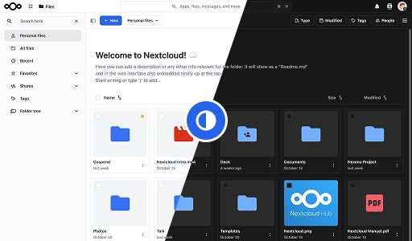
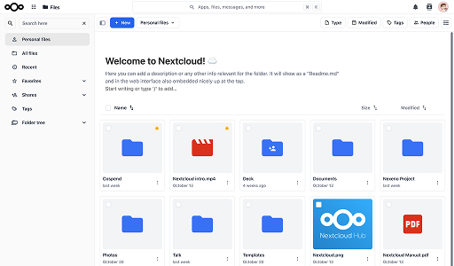
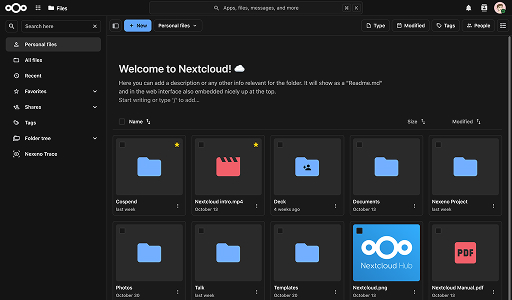

<!--
  - SPDX-FileCopyrightText: 2026 Nexeno contributors
  - SPDX-License-Identifier: AGPL-3.0-or-later
-->
<div align="center">


# Nexeno Theme - Un thème Nextcloud

**Votre cloud. Votre marque.<br>Votre expérience.**

[](https://github.com/Nexeno-HQ/nexeno_theme/releases/latest) [](#pour-les-administrateurs) [](#pour-les-administrateurs) [](LICENSE) [](https://apps.nextcloud.com/apps/nexeno_theme)

[English](README.md) · [Deutsch](README.de.md) · **Français**


</div>

Nexeno Theme redessine Nextcloud et les applications que votre équipe utilise chaque jour dans un design cohérent. Il
reste désactivé tant qu'un utilisateur ne l'active pas, et il ne modifie jamais ses propres paramètres d'apparence
Nextcloud : revenir en arrière ne demande qu'un clic. Conçu et maintenu par [Nexeno](https://nexeno.io/).

| Par défaut du système | Nexeno Clair | Nexeno Sombre |
|:---:|:---:|:---:|
|  |  |  |
| Suit le réglage clair ou sombre de l'appareil | Lumineux et calme pour travailler en journée | Reposant pour les yeux le soir |

## Prêt en une minute

1. Dans Nextcloud, ouvrez **Applications**, cherchez **Nexeno Theme** et cliquez sur **Télécharger et activer**.
2. Ouvrez **Paramètres personnels → Apparence et accessibilité**.
3. Choisissez **Par défaut du système**, **Nexeno Clair** ou **Nexeno Sombre**. La nouvelle apparence s'affiche
   immédiatement, dans chaque onglet ouvert.

Les mises à jour arrivent par la gestion des applications de Nextcloud, comme pour toute application du magasin.

## Pour vos utilisateurs

- **Leur choix, pas le vôtre.** Chacun active ou désactive le thème pour lui-même. Personne ne se voit imposer une
  nouvelle apparence.
- **Partout avec eux.** Le choix est enregistré avec le compte et s'applique sur chaque appareil et chaque navigateur.
- **Clair, Sombre ou automatique.** Par défaut du système passe de Nexeno Clair à Nexeno Sombre quand l'appareil change.
- **Dans leur langue.** Anglais, allemand (tutoiement et vouvoiement), français, néerlandais, italien, espagnol,
  suédois, danois, norvégien, finnois, tchèque et portugais (Brésil).
- **Leur propre couleur.** La couleur principale qu'un utilisateur choisit dans *Paramètres personnels → Apparence
  et accessibilité* remplace le bleu Nexeno, ajustée si besoin pour que le texte reste lisible en Clair et en Sombre.
- **Accessibilité respectée.** Le mode contraste élevé de Nextcloud fonctionne avec Nexeno clair et sombre, y compris
  lorsque l'appareil demande plus de contraste, avec un texte au rapport de contraste 7:1 (WCAG AAA). Si l'appareil
  demande moins d'animations, le survol n'anime plus rien et le défilement n'est plus progressif. Les utilisateurs qui
  ont choisi la police OpenDyslexic la conservent.

## Pour les administrateurs

- **Fonctionne avec ce que vous avez.** Nextcloud 32, 33, 34 et 35, avec des correctifs adaptés à chaque version.
  Nextcloud 36 est pris en charge en préversion.
- **Rien de plus à installer.** Ni tâche d'arrière-plan, ni serveur e-mail, ni application supplémentaire.
- **Vous choisissez la page de connexion.** Gardez la page de connexion Nexeno ou revenez à la page standard.
- **La couleur de votre organisation.** Affichez la couleur principale de *Paramètres d'administration →
  Personnaliser l'apparence* à la place du bleu Nexeno. La couleur qu'un utilisateur a choisie lui-même reste
  prioritaire. Désactivé par défaut.
- **Un menu des applications bien rangé.** Affichez ou masquez l'entrée *Nexeno Theme* du menu des applications.
- **Suppression propre.** Une commande efface tous les paramètres avant la désinstallation.

Les trois options se trouvent dans *Paramètres personnels → Apparence et accessibilité* (visibles uniquement par les
administrateurs), ou en ligne de commande :

```bash
sudo -u www-data php occ config:app:set nexeno_theme login_style --value=no   # page de connexion standard de Nextcloud
sudo -u www-data php occ config:app:set nexeno_theme app_menu --value=no      # masquer l'entrée du menu
sudo -u www-data php occ config:app:set nexeno_theme organisation_colour --value=yes   # couleur de l'organisation
```

## Pour votre délégué à la protection des données

- **Rien ne quitte votre serveur.** Le thème fonctionne entièrement dans votre Nextcloud et ne charge rien depuis des
  services externes : ni polices, ni scripts, ni suivi de tiers.
- **Données minimales.** Pour chaque utilisateur, il enregistre seulement la variante choisie, la dernière variante activée
  et s'il a répondu à la demande de notation (avec, après l'avoir fermée, la date à laquelle la reposer). Pour
  l'instance, il enregistre les trois options (page de connexion, couleur de l'organisation, menu des applications) et
  la date d'installation ; aucune de ces données n'est personnelle. La
  fermeture de la bannière Nexeno Project n'est mémorisée que dans le navigateur de l'utilisateur.
- **Portable.** Les variantes choisies et la réponse à la demande de notation sont incluses lorsqu'un utilisateur
  exporte son compte avec la migration de compte de Nextcloud.
- **Effaçable.** Désactiver l'application conserve tous les paramètres. Pour la supprimer définitivement sans rien
  laisser derrière :

```bash
sudo -u www-data php occ nexeno_theme:purge-settings --force
sudo -u www-data php occ app:remove nexeno_theme
```

## Des applications soignées

| | |
|---|---|
| **📁 Fichiers et documents** | Fichiers, Photos, Texte, Office |
| **💬 Travailler ensemble** | Talk, Mail, Agenda, Contacts, Équipes, Collectives |
| **✅ Rester organisé** | Tableau de bord, Activité, Deck, Notes, Tâches, Cospend |
| **🧭 Nextcloud lui-même** | Navigation, menus de l'en-tête, recherche, boîtes de dialogue, barres latérales, page de connexion, magasin d'applications, paramètres personnels et d'administration |
| **🧩 Applications Nexeno** | Des applications comme Nexeno Project gardent leur propre design. Le thème les laisse inchangées. |

## Captures d'écran


## Questions fréquentes

**Le thème modifie-t-il les paramètres d'apparence Nextcloud des utilisateurs ?**
Non. Désactiver le thème rétablit exactement ce que l'utilisateur avait avant.

**Puis-je le proposer seulement à certaines personnes ?**
Oui. Il est désactivé pour tous tant que chacun ne l'active pas lui-même.

**Que se passe-t-il si je désactive l'application ?**
Chacun retrouve son apparence Nextcloud habituelle. Les choix sont conservés et reviennent si vous réactivez
l'application.

**Je l'ai installé à la main et rien n'a changé.**
Vous avez probablement téléchargé l'archive « Source code ». Utilisez plutôt **`nexeno_theme.tar.gz`** dans les
fichiers joints de la version (voir ci-dessous).

## Installation manuelle

Téléchargez **`nexeno_theme.tar.gz`** dans les fichiers joints de la [dernière version](https://github.com/Nexeno-HQ/nexeno_theme/releases),
et non l'archive « Source code » (zip ou tar.gz) : elle ne contient pas les styles et scripts compilés, et le thème ne
fonctionnerait pas. Décompressez-la dans le dossier `custom_apps` de votre Nextcloud (le dossier doit s'appeler
`nexeno_theme`), puis activez l'application :

```bash
tar -xzf nexeno_theme.tar.gz -C /path/to/nextcloud/custom_apps
sudo -u www-data php occ app:enable nexeno_theme
```

Pour une mise à jour manuelle, remplacez le dossier par la nouvelle version et lancez
`sudo -u www-data php occ upgrade`.

## Aide et contact

- **Quelque chose s'affiche mal ?** [Ouvrez une issue](https://github.com/Nexeno-HQ/nexeno_theme/issues) avec votre
  version de Nextcloud, l'application concernée et une capture d'écran.
- **Questions ou demandes commerciales :** [support@nexeno.io](mailto:support@nexeno.io)
- **Problèmes de sécurité :** signalez-les en privé, comme décrit dans [SECURITY.md](SECURITY.md), et non dans des
  issues publiques.
- **Nouveautés :** consultez le [journal des modifications](CHANGELOG.md).

⭐ **Nexeno Theme vous plaît ? [Notez-le sur le magasin d'applications Nextcloud](https://apps.nextcloud.com/apps/nexeno_theme).**
Cela aide d'autres personnes à le trouver.

## Développement

<details>
<summary>Installer, compiler, vérifier et publier</summary>

### Environnement Nextcloud

Il vous faut un [environnement de développement](https://docs.nextcloud.com/server/latest/developer_manual/getting_started/devenv.html)
de la version actuelle de Nextcloud, ou le [conteneur Docker Nextcloud](https://hub.docker.com/_/nextcloud/). Clonez
ensuite l'application dans le dossier `custom_apps` :

```bash
cd custom_apps
git clone https://github.com/Nexeno-HQ/nexeno_theme.git
cd nexeno_theme
```

### Compiler le thème

Vérifiez que [Node.js](https://nodejs.org/) 22.14 ou plus récent est installé, puis compilez et activez l'application :

```bash
npm ci
npm run build
php ../../occ app:enable nexeno_theme
```

Pendant que vous travaillez sur les styles, cette commande recompile le CSS à chaque modification :

```bash
npm run watch
```

- `scss/nexeno-theme.scss` est la feuille de style de base pour toutes les versions prises en charge.
- `scss/nexeno-theme-vNN.scss` contient les correctifs propres à une version, chargés après la feuille de style de base.
- Les couleurs viennent uniquement des variables du thème dans `scss/_themes.scss`, pour que Clair et Sombre restent
  alignés.
- Les captures d'écran des pages de l'application vont par paires, `<name>-light` et `<name>-dark`, dans
  `src/assets/images/`. Affichez les deux, avec les classes `showcase-img--light` et `showcase-img--dark` :
  `scss/page/_page-shared.scss` montre celle qui correspond au thème actuel. Exportez les images sans coins arrondis
  (Figma intègre des coins blancs dans les exports de cadres arrondis) et laissez le CSS les arrondir.
- `css/` et `js/page/` sont générés par la compilation : ils ne sont pas dans git, lancez donc `npm run build` après le
  clonage. Les autres fichiers de `js/` sont écrits à la main et versionnés.

### Vérifications

Installez une fois les paquets npm et composer avec `make install-deps`, puis :

```bash
make lint       # ESLint, Stylelint, PHP syntax, PHP code style and Psalm
make cs-fix     # fix PHP code style
make test       # PHP unit tests and browser-script tests (no Nextcloud server needed)
make l10n       # update translationfiles/templates/nexeno_theme.pot
```

`make l10n` nécessite l'[outil de traduction](https://github.com/nextcloud/docker-ci/tree/master/translations/translationtool)
de Nextcloud ; indiquez le fichier `.phar` dans `TRANSLATIONTOOL` s'il ne se trouve pas à `../translationtool.phar`.

### Préparer une version

```bash
make appstore   # build and package build/artifacts/nexeno_theme.tar.gz
make sign       # sign the app files (appinfo/signature.json), repack, print the App Store signature
```

`make sign` attend le certificat et la clé du magasin d'applications dans `~/.nextcloud/certificates/nexeno_theme.crt`
et `.key`, et exécute `occ integrity:sign-app`. Si occ tourne dans un conteneur, montez-y `build/nexeno_theme` et
passez `OCC="…"` et `SIGN_PATH=<chemin dans le conteneur>`. La
[documentation développeur du magasin d'applications](https://nextcloudappstore.readthedocs.io/en/latest/developer.html)
explique comment demander le certificat et enregistrer l'application.

### Contribuer

Lancez `make lint` et `make test` avant d'ouvrir une pull request, et gardez chaque modification assez petite pour être
vérifiée dans le navigateur sur chaque version de Nextcloud prise en charge.

</details>

## Licence

Cette application est distribuée sous licence [AGPL-3.0-or-later](LICENSE).
