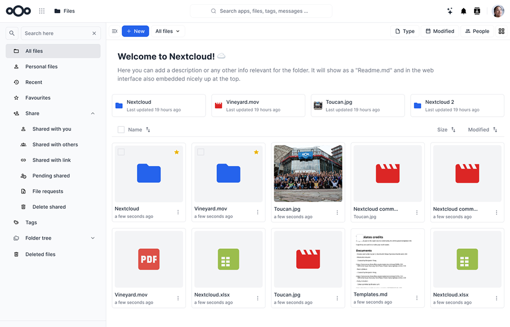

<!--
  - SPDX-FileCopyrightText: 2026 Nexeno contributors
  - SPDX-License-Identifier: AGPL-3.0-or-later
-->
# Nexeno theme

Nexeno theme brings the Nexeno brand colours to Nextcloud in a light and a dark variant.

- Choose Off, Light or Dark per account under Personal settings → Appearance
- Restyled navigation, dialogs, popovers, settings and login pages
- Tailored layouts for Files, Photos, Dashboard, Activity, Calendar, Contacts, Deck, Notes, Tasks, Talk, Collectives, Mail and more
- Works with Nextcloud 32, 33, 34 and 35



## Installation/Update

The app can be installed through the app store within Nextcloud. You can also download the latest release from the [release page](https://github.com/TODO-owner/nexeno_theme/releases).

## Developing

### Nextcloud environment

You need to set up a [development environment](https://docs.nextcloud.com/server/latest/developer_manual/getting_started/devenv.html) of the current Nextcloud version. You can also alternatively install and run the [nextcloud docker container](https://hub.docker.com/_/nextcloud/).
After the finished installation, clone the app repository into the `custom_apps` folder:

```bash
cd custom_apps
git clone https://github.com/TODO-owner/nexeno_theme.git
cd nexeno_theme
```

### Building the theme

Make sure you have [Node.js](https://nodejs.org/) 20 or newer installed, then build and enable the app:

```bash
npm ci
npm run build
php ../../occ app:enable nexeno_theme
```

While working on the styles, rebuild the CSS on every change:

```bash
npm run watch
```

- `scss/nexeno-theme.scss` is the base stylesheet for every supported version.
- `scss/nexeno-theme-vNN.scss` holds version-specific fixes, loaded after the base stylesheet.
- Colours come only from the theme variables in `scss/_themes.scss`, so Light and Dark stay in sync.
- The compiled `css/` and `js/` output is committed, because Nextcloud serves it directly.

### Packaging a release

```bash
make appstore   # build and package build/artifacts/nexeno_theme.tar.gz
make sign       # print the signature for the App Store upload form
```

`make sign` expects the App Store certificate key at `~/.nextcloud/certificates/nexeno_theme.key`. See the [App Store developer documentation](https://nextcloudappstore.readthedocs.io/en/latest/developer.html) to request the certificate and register the app.

## Contribution Guidelines

Please read the [Code of Conduct](https://nextcloud.com/community/code-of-conduct/). This document offers some guidance to ensure Nextcloud participants can cooperate effectively in a positive and inspiring atmosphere, and to explain how together we can strengthen and support each other.

For more information please review the [guidelines for contributing](https://github.com/nextcloud/server/blob/master/.github/CONTRIBUTING.md) to this repository.

## License

This app is licensed under the [AGPL-3.0-or-later](LICENSE).
