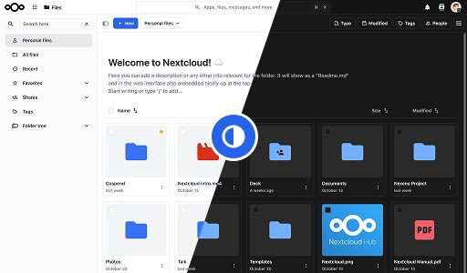
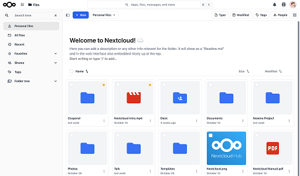
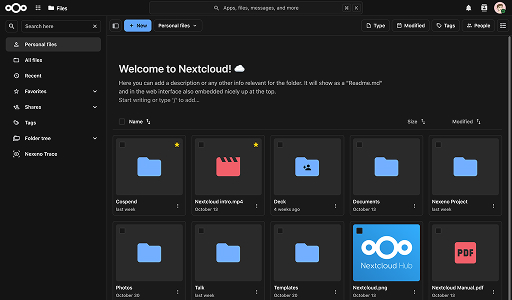

<!--
  - SPDX-FileCopyrightText: 2026 Nexeno contributors
  - SPDX-License-Identifier: AGPL-3.0-or-later
-->
<div align="center">


# Nexeno Theme - A Nextcloud Theme

**Your cloud. Your brand.<br>Your experience.**

[](https://github.com/Nexeno-HQ/nexeno_theme/releases/latest) [](#for-administrators) [](#for-administrators) [](LICENSE) [](https://apps.nextcloud.com/apps/nexeno_theme)

**English** · [Deutsch](README.de.md) · [Français](README.fr.md)


</div>

Nexeno Theme restyles Nextcloud and the apps your team uses every day in one consistent design. It is off until a
user turns it on, and it never touches their own Nextcloud appearance settings, so switching back is always one click
away. Made and maintained by [Nexeno](https://nexeno.io/).

| System default | Nexeno Light | Nexeno Dark |
|:---:|:---:|:---:|
|  |  |  |
| Follows the device's light or dark setting | Bright and calm for daytime work | Easy on the eyes after dark |

## Get started in one minute

1. In Nextcloud, open **Apps**, search for **Nexeno Theme** and click **Download and enable**.
2. Open **Personal settings → Appearance and accessibility**.
3. Choose **System default**, **Nexeno Light** or **Nexeno Dark**. The new look appears straight away, in every open tab.

Updates arrive through Nextcloud's own app management, like any other App Store app.

## For your users

- **Their choice, not yours.** Each person turns the theme on or off for themselves. Nobody is forced into a new look.
- **Follows them everywhere.** The choice is saved with their account, so it applies on every device and browser.
- **Light, Dark or automatic.** System default switches between Nexeno Light and Nexeno Dark when the device does.
- **In their language.** English, German (informal and formal), French, Dutch, Italian, Spanish, Swedish, Danish,
  Norwegian, Finnish, Czech and Portuguese (Brazil).
- **Their own colour.** A primary colour a user picks under *Personal settings → Appearance and accessibility* is
  used in place of the Nexeno blue, adjusted where needed so text stays readable in Light and Dark.
- **Accessibility respected.** Nextcloud's high-contrast mode works on top of Nexeno Light and Dark, also when the
  device asks for more contrast, with text at a 7:1 contrast ratio (WCAG AAA). A device set to reduce motion gets no
  hover animations or smooth scrolling. Users who chose the OpenDyslexic font keep it.

## For administrators

- **Runs on what you have.** Nextcloud 32, 33, 34 and 35, with fixes tuned for each version. Nextcloud 36 is
  supported as a pre-release.
- **Nothing extra to set up.** No background jobs, email server or extra apps.
- **You decide the login page.** Keep the Nexeno login page or go back to the standard one.
- **Use your organisation's colour.** Show the primary colour from *Administration settings → Theming* in place of the
  Nexeno blue. A colour a user picks for themselves still comes first. Off by default.
- **Keep the app menu tidy.** Show or hide the *Nexeno Theme* entry in the app menu.
- **Clean removal.** One command erases every setting before you uninstall.

All three switches are in *Personal settings → Appearance and accessibility* (visible to administrators only), or on the
command line:

```bash
sudo -u www-data php occ config:app:set nexeno_theme login_style --value=no   # standard Nextcloud login page
sudo -u www-data php occ config:app:set nexeno_theme app_menu --value=no      # hide the app-menu entry
sudo -u www-data php occ config:app:set nexeno_theme organisation_colour --value=yes   # organisation's colour
```

## For your data protection officer

- **Nothing leaves your server.** The theme runs fully inside your Nextcloud and loads nothing from outside services:
  no fonts, scripts or tracking from third parties.
- **Minimal data.** For each user it stores only the chosen variant, the variant they last turned on, and whether they
  answered the rating popup (with the date to ask again after closing it). For the instance it stores the three
  switches (login page, organisation colour, app menu) and the install date, which hold no personal data. Closing the
  Nexeno Project banner is remembered only in the user's own browser.
- **Portable.** The chosen variants and the answer to the rating popup are included when a user exports their account
  with Nextcloud's account migration.
- **Erasable.** Disabling the app keeps every setting. To remove it for good without leaving anything behind:

```bash
sudo -u www-data php occ nexeno_theme:purge-settings --force
sudo -u www-data php occ app:remove nexeno_theme
```

## Apps that look right

| | |
|---|---|
| **📁 Files and documents** | Files, Photos, Text, Office |
| **💬 Working together** | Talk, Mail, Calendar, Contacts, Teams, Collectives |
| **✅ Getting organised** | Dashboard, Activity, Deck, Notes, Tasks, Cospend |
| **🧭 Nextcloud itself** | Navigation, header menus, search, dialogs, sidebars, login page, App store, personal and admin settings |
| **🧩 Nexeno apps** | Apps such as Nexeno Project keep their own built-in design. The theme leaves them unchanged. |

## Screenshots


## Questions and answers

**Does the theme change anyone's Nextcloud appearance settings?**
No. Turning the theme off brings back exactly what the user had before.

**Can I roll it out to only some people?**
Yes. It is off for everyone until each person turns it on.

**What happens if I disable the app?**
Everyone sees their usual Nextcloud look again. Their choices are kept, so turning the app back on restores them.

**I installed it by hand and nothing looks different.**
You probably downloaded the "Source code" archive. Use **`nexeno_theme.tar.gz`** from the release's assets instead
(see below).

## Manual installation

Download **`nexeno_theme.tar.gz`** from the assets of the [latest release](https://github.com/Nexeno-HQ/nexeno_theme/releases),
not the "Source code" zip or tar.gz: those don't contain the built styles and scripts, so the theme won't work. Extract
it into your Nextcloud's `custom_apps` folder (the folder must be named `nexeno_theme`), then enable it:

```bash
tar -xzf nexeno_theme.tar.gz -C /path/to/nextcloud/custom_apps
sudo -u www-data php occ app:enable nexeno_theme
```

To update by hand, replace the folder with the new release and run `sudo -u www-data php occ upgrade`.

## Help and contact

- **Something looks wrong?** [Open an issue](https://github.com/Nexeno-HQ/nexeno_theme/issues) with your Nextcloud
  version, the app and a screenshot.
- **Questions or business enquiries:** [support@nexeno.io](mailto:support@nexeno.io)
- **Security issues:** report them privately as described in [SECURITY.md](SECURITY.md), not in public issues.
- **Accessibility:** what the theme supports and its known gaps are in [ACCESSIBILITY.md](ACCESSIBILITY.md).
- **What's new:** see the [changelog](CHANGELOG.md).

⭐ **Enjoying Nexeno Theme? [Rate it on the Nextcloud App Store](https://apps.nextcloud.com/apps/nexeno_theme).** It
helps other people find it.

## Developing

<details>
<summary>Set up, build, check and release</summary>

### Nextcloud environment

You need a [development environment](https://docs.nextcloud.com/server/latest/developer_manual/getting_started/devenv.html)
of the current Nextcloud version, or the [Nextcloud Docker container](https://hub.docker.com/_/nextcloud/). Then clone
the app into the `custom_apps` folder:

```bash
cd custom_apps
git clone https://github.com/Nexeno-HQ/nexeno_theme.git
cd nexeno_theme
```

### Building the theme

Make sure you have [Node.js](https://nodejs.org/) 22.14 or newer installed, then build and enable the app:

```bash
npm ci
npm run build
php ../../occ app:enable nexeno_theme
```

While working on the styles, rebuild the CSS on every change:

```bash
npm run watch
```

- `scss/nexeno-theme.scss` is the base stylesheet for every supported version.
- `scss/nexeno-theme-vNN.scss` holds version-specific fixes, loaded after the base stylesheet.
- Colours come only from the theme variables in `scss/_themes.scss`, so Light and Dark stay in sync.
- Screenshots on the app's own pages come in pairs, `<name>-light` and `<name>-dark`, in `src/assets/images/`. Render
  both, with the classes `showcase-img--light` and `showcase-img--dark`: `scss/page/_page-shared.scss` shows the one
  that matches the current theme. Export images without rounded corners (Figma bakes white corners into exports of
  rounded frames) and let the CSS round them.
- `css/` and `js/page/` are build output: they are not in git, so run `npm run build` after cloning. The other files
  in `js/` are hand-written and committed.

### Checks

Install the npm and composer packages once with `make install-deps`, then:

```bash
make lint       # ESLint, Stylelint, PHP syntax, PHP code style and Psalm
make cs-fix     # fix PHP code style
make test       # PHP unit tests and browser-script tests (no Nextcloud server needed)
make l10n       # update translationfiles/templates/nexeno_theme.pot
```

`make l10n` needs the Nextcloud [translation tool](https://github.com/nextcloud/docker-ci/tree/master/translations/translationtool);
point `TRANSLATIONTOOL` at the `.phar` if it is not at `../translationtool.phar`.

### Packaging a release

```bash
make appstore   # build and package build/artifacts/nexeno_theme.tar.gz
make sign       # sign the app files (appinfo/signature.json), repack, print the App Store signature
```

`make sign` expects the App Store certificate and key at `~/.nextcloud/certificates/nexeno_theme.crt` and `.key`, and
runs `occ integrity:sign-app`. When occ runs in a container, mount `build/nexeno_theme` into it and pass `OCC="…"` and
`SIGN_PATH=<path inside the container>`. See the
[App Store developer documentation](https://nextcloudappstore.readthedocs.io/en/latest/developer.html) to request the
certificate and register the app.

### Contributing

Run `make lint` and `make test` before opening a pull request, and keep each change small enough to review in the
browser on every supported Nextcloud version.

</details>

## License

This app is licensed under the [AGPL-3.0-or-later](LICENSE).
